> **作者**：Chen Fangshuo（ForSure） · 2026-10-17 · 首发于 [forsure.live](https://forsure.live/double-pulse-test-at-home/)
>
> 文字与图片版权归作者所有，转载请注明出处并链回原文。配套脚本 `dpt_analyzer.py`：Copyright (c) 2026 Chen Fangshuo，`SPDX-License-Identifier: MIT`，完整许可文本见[仓库 LICENSE](https://github.com/chenfangshuo/chenfangshuo.github.io/blob/main/LICENSE)。

**为什么要在家里搭 DPT？** Datasheet 里的开关时间和损耗，都是在厂商指定的测试环境（特定的换流回路电感 L_loop、栅极电阻 Rg、母线电压和探头带宽）下测出来的，每家的口径还不一样，对选型帮助有限。真正做高频或大电流电源时，只有自己跑一遍 DPT，才能知道管子在自己板子上的真实表现；而且这套平台可以反复用来横向对比不同器件，在电源第一次上电之前把 Rg、Cgs、缓冲电路调好——总比上电就炸机强。

**本文目标**：用一套低成本、可复现的桌面设备，完成一颗 100 V、1.7 mΩ、TOLT 封装 SGT MOSFET 的双脉冲测试；再用一份 Python 脚本替代示波器的付费电源分析选件，把开关时间、开关损耗、回路电感、负载电感和 Qrr 一次性算出来。

<!--more-->

### 桌面 DPT 平台搭建

#### 1. 主回路

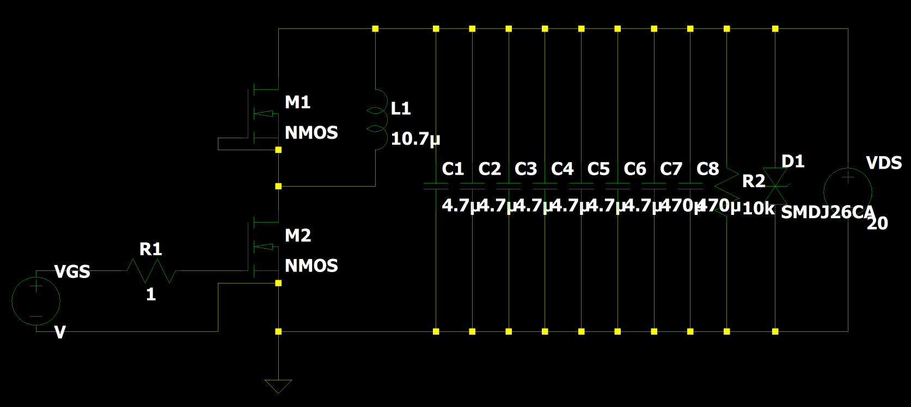

电路原理如上：两颗 MOS 组成上下桥，**上桥的 G 与 KS 短接**，作为续流管；**下桥是斩波管**，负责执行双脉冲动作。上桥两端接一个 L=10.7 µH 的空心电感作为负载。下桥栅极与 MOS 之间串了 Rg,ext=1 Ω 的开关电阻。

母线用了 6 颗 100 V/4.7 µF MLCC，为高频开关瞬间提供能量；再加 2 颗 50 V/470 µF 固态电容，给电感持续充电（50 V 是因为手头只有这个）。母线并联 10 kΩ 泄放电阻和 3000 W/26 V TVS，防止关断电压尖峰把固态电容或电源击穿。

#### 2. 被测件（DUT）

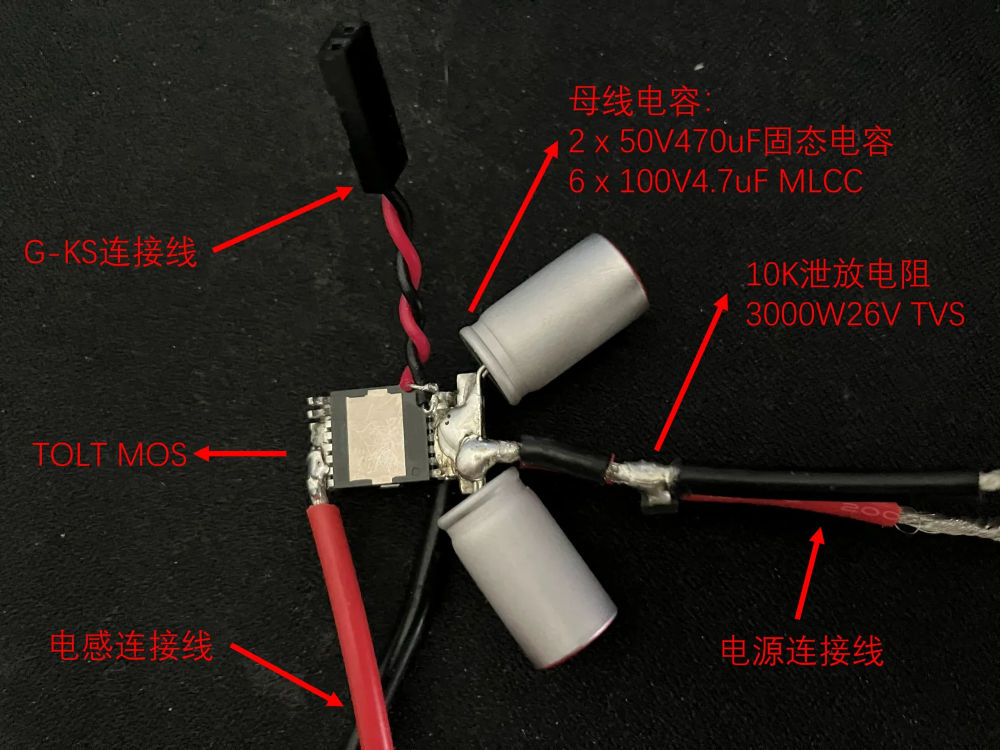

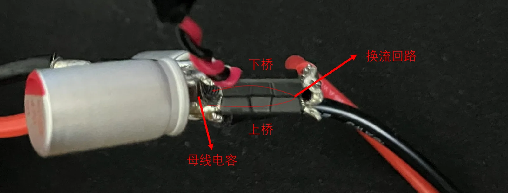

被测件是一颗 **100 V、1.7 mΩ、TOLT 封装的 SGT MOSFET**，Qg(0~10 V)≈150 nC，Ciss@50 V≈10 nF，规格算是比较豪华。没有专门的测试板，为了降低杂散电感，利用互感抵消的原理，把上下桥两颗 MOS 背靠背紧贴着放，母线电容→上桥→下桥形成垂直回路。另外引出独立的 KS 引脚接到驱动板，进一步提高开关速度。

#### 3. 发波板与隔离驱动板

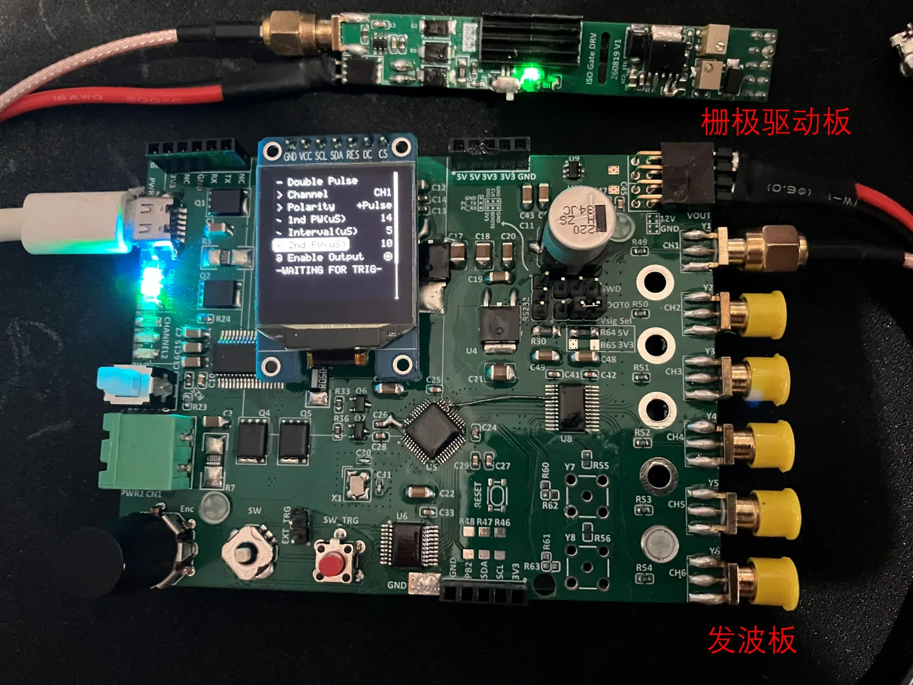

采用自己 DIY 的发波板与隔离驱动板：

- 发波板（STM32G474）演示视频：[BV1gYbP6MECp](https://www.bilibili.com/video/BV1gYbP6MECp/)
- 隔离驱动板（1ED3123 + UCC34141）演示视频：[BV1iWYJ6PESi](https://www.bilibili.com/video/BV1iWYJ6PESi)
- 发波板固件已开源：[chenfangshuo/G474PulseGen](https://github.com/chenfangshuo/G474PulseGen)

发波板还带 SCPI Server，后面可以接自动扫频/扫电流的脚本，做开关时间随电流变化的特性曲线。

#### 4. 空心电感

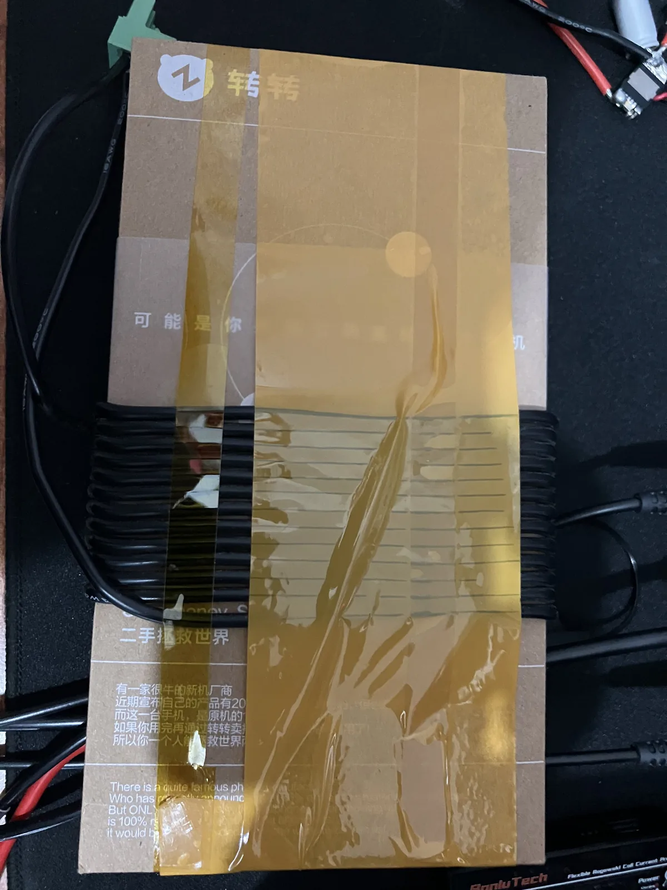

来自转转家的电感（大雾）——其实是实在找不到合适的东西绕电感了，绕了 13 圈，实测感值 10.7 µH。

#### 5. 电源

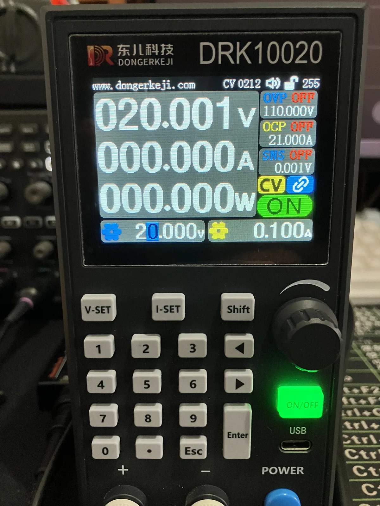

电源是东儿科技的 DRK10020，100 V/20 A。其实电源功率没必要很大，它只需要给母线电容提供一点点充电电流，所以设置成 **20 V / 0.1 A 限流**。这样就算后面炸了，电源也不会持续提供能量，能少冒一点烟。

#### 6. 测试仪器与接线

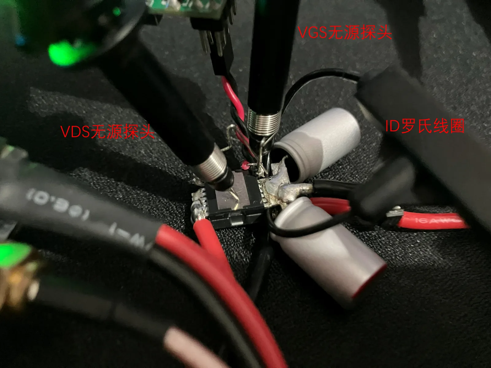

- 示波器：鼎阳 SDS804X HD（70 MHz、2 GSa/s、12 bit）
- 无源探头：示波器自带的 PB470
- 电流探头：波妞科技 HQRocoil-Mini 罗氏线圈

通道映射：**CH1 = VGS，CH2 = ID，CH3 = VDS**。罗氏线圈在示波器里已经做了 **+27 ns** 的 Deskew，导出的 CSV 里也带着这个校准；脚本默认不再重复补偿，但保留了一个软件微调开关。

| 项目 | 设置 |
|:---|:---|
| 母线电压 | 20.0 V，限流 0.1 A |
| 负载电感 | 10.7 µH（13 圈空心） |
| 栅极电阻 | Rg,ext = 1 Ω |
| 驱动电平 | 0 V / 10 V |
| 第一脉冲宽度 | 14.0 µs |
| 死区 | 5.0 µs |
| 第二脉冲宽度 | 10.0 µs |
| 电流探头 | HQRocoil-Mini（硬件 Deskew +27 ns） |

### 实测波形

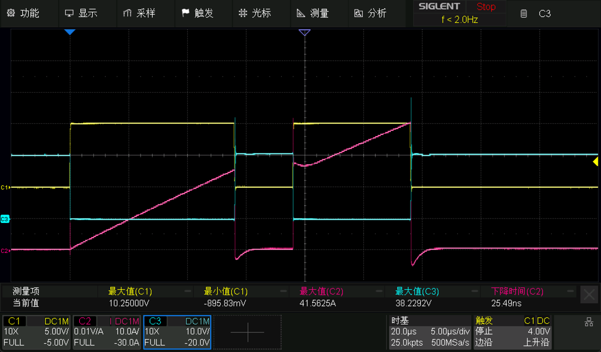

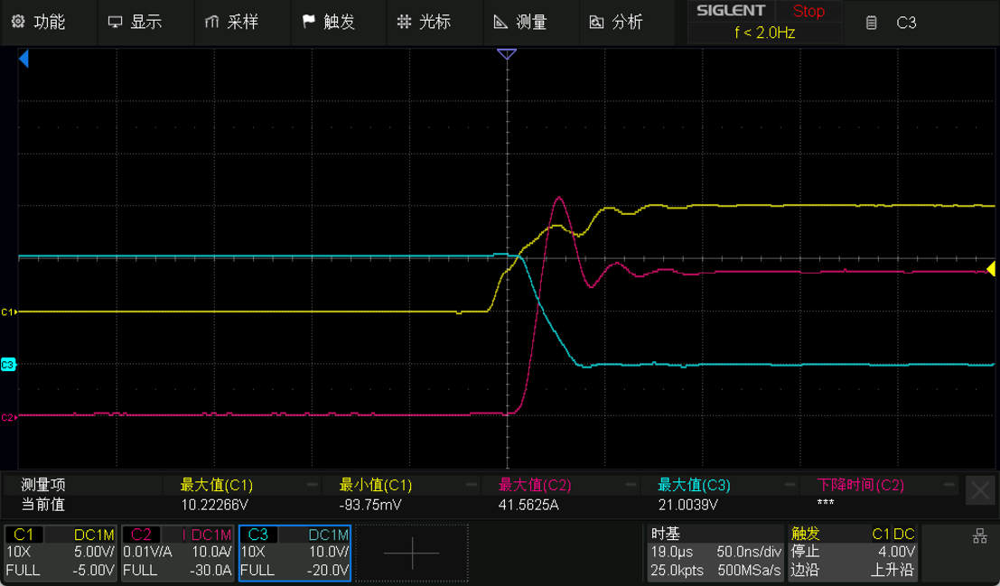

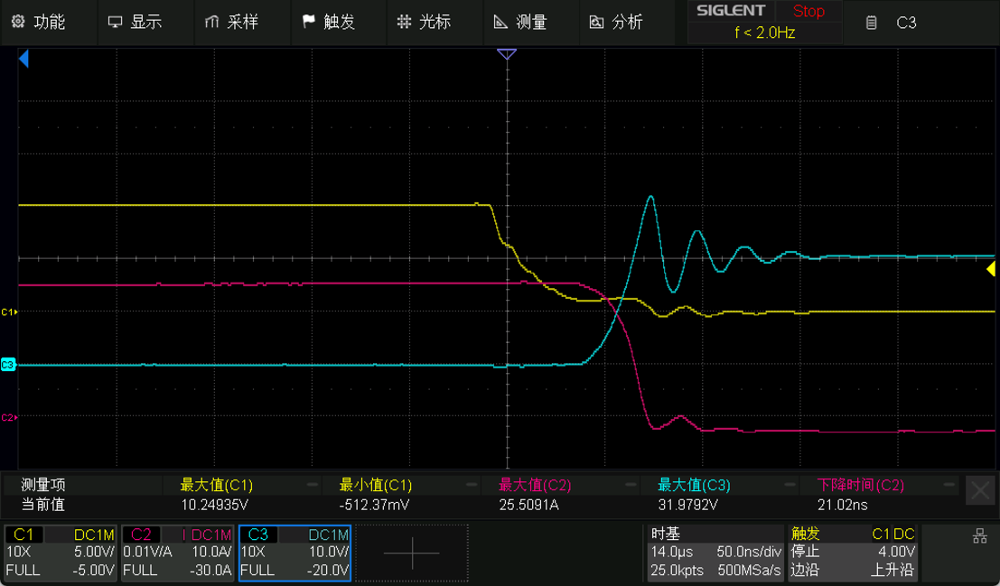

全波形里能看到两次开通、两次关断：第一次关断发生在 14 µs 左右，第二次开通在 19 µs 左右，第二次关断在 29 µs 左右。标准 DPT 只关心**第一次关断（Eoff）**和**第二次开通（Eon）**，所以脚本也是按这两段算的。

第一次关断时，负载电流约 25 A（示波器峰值读数 25.51 A），VDS 峰值 31.98 V，相对 20.04 V 母线过冲 11.94 V。示波器光标给的电流下降时间是 21.02 ns；脚本按 JEDEC 的 **90%–10%** 统一口径算得 tf=19.14 ns、dI/dt=1.04 A/ns，对应

$$
L_{loop}=\frac{V_{peak}-V_{bus}}{dI/dt}=\frac{31.98-20.04}{1.04}\approx 11.5\ \text{nH}
$$

对“手搓”的上下桥来说，这个回路电感还能接受。第二次开通时，反向恢复电流把 ID 顶到 41.56 A，相对关断前的 24.81 A，IRM≈16.5 A，脚本估的 Qrr≈190 nC。

第二次关断的电压尖峰更高（全波形里 CH3 最大到 38.2 V），因为那时电感电流已经爬到约 40 A；本文不展开第二次关断的损耗。除了反向恢复和 Cgd 耦合带来的振铃，整体波形算是很干净了。

### 数据处理——Python 自动化

在示波器上用光标手动卡开关时间、用 Math 测开关损耗，既费时间又费眼睛；而且示波器端如果没做基线校准（Zero-offset）和 Deskew，卡出来的参数误差不小。所以这里用一份脚本直接读示波器导出的 CSV，自动完成计算。

#### 1. 怎么用

脚本就在文章同目录，文件名 `dpt_analyzer.py`。依赖 `numpy`、`pandas`、`scipy`、`matplotlib`：

```powershell
pip install numpy pandas scipy matplotlib
```

> 脚本里的积分用的是 `scipy.integrate.trapezoid`，NumPy 1.x 和 2.x 都能跑（不依赖 NumPy 2.x 才有的 `np.trapezoid`）。

把三份 CSV 放在当前目录，直接运行即可自动扫描 `*_C1_*.csv` 并推导 C2/C3：

```powershell
python dpt_analyzer.py
```

完整参数可以直接看脚本自带的帮助（下面把同一份帮助按用途整理成了表格）：

```powershell
python dpt_analyzer.py -h
```

比较常用的几条命令：

```powershell
# 显式指定三个通道
python dpt_analyzer.py -c1 usr_wf_C1_data.csv -c2 usr_wf_C2_data.csv -c3 usr_wf_C3_data.csv

# 导出处理后的波形和指标
python dpt_analyzer.py --export-csv dpt_processed.csv --export-metrics dpt_metrics.csv

# 打开罗氏线圈补偿（默认关闭）
python dpt_analyzer.py --rogowski HQRocoil-Mini

# 固定分析窗口，并且不弹窗（适合远程/无头环境）
python dpt_analyzer.py --window manual --pre-ns 80 --post-ns 200 --no-show
```

**输入文件**

| 参数 | 作用 |
|:---|:---|
| `-c1` / `-c2` / `-c3` | 三通道 CSV（VGS / ID / VDS）。省略时自动扫描当前目录的 `*_C1_*.csv`，并用文件名推导 C2/C3 |
| `--data-dir DIR` | 自动扫描目录，默认 `.` |

**分析窗口与边沿识别**

| 参数 | 作用 |
|:---|:---|
| `--window {auto,manual}` | 分析窗口模式。`auto` 按实测开关时间自动定宽；`manual` 使用下面的 pre/post（默认 `auto`） |
| `--pre-ns` / `--post-ns` | manual 模式的前窗 / 后窗，单位 ns（默认 60 / 160） |
| `--smooth-ns` | VGS 移动平均窗宽，单位 ns（默认 10） |
| `--min-pulse-ns` | 最小有效脉宽，单位 ns（默认 200） |
| `--edge-hyst` | 边沿迟滞比例，0~0.5（默认 0.10） |
| `--deskew-id-ns` | ID 软件 deskew，单位 ns（默认 0；正值为电流提前） |
| `--no-auto-zero` | 关闭自动零偏校准（默认开启） |

**罗氏线圈补偿**

| 参数 | 作用 |
|:---|:---|
| `--rogowski [PRESET]` | 开启补偿；不带预设名时使用 `HQRocoil-Mini` |
| `--no-rogowski` | 强制关闭补偿（覆盖文件顶部的 `ENABLE_ROGOWSKI_COMP`） |
| `--rogowski-tau-us` / `--rogowski-gain` | 临时覆盖预设里的时间常数 / 高通失配增益 |

**输出**

| 参数 | 作用 |
|:---|:---|
| `--out-dir DIR` | 图片和导出 CSV 的输出目录（默认当前目录） |
| `--export-csv [PATH]` | 导出处理后的时域 CSV；不带路径时写 `dpt_processed.csv` |
| `--export-metrics [PATH]` | 导出指标汇总 CSV；不带路径时写 `dpt_metrics.csv` |
| `--no-plot` | 不生成分析图 |
| `--no-show` | 生成分析图但不弹窗（服务器 / 无头环境） |

**手工覆盖与报告**

| 参数 | 作用 |
|:---|:---|
| `--t-on1-us` 等四个时刻 | 手工指定第一开通、第一关断、第二开通、第二关断时刻，单位 µs；四个都给齐时跳过自动边沿识别 |
| `--title` / `--device` | 报告和分析图标题 / 被测器件描述 |
| `--verbose` | 打印输入路径、点数等调试信息 |
| `-h` / `--help` | 打印完整帮助 |

导出的文件长这样：

| 文件 | 内容 |
|:---|:---|
| `dpt_processed.csv` | 列：`Time_s, VGS_V, ID_A, VDS_V, P_W, E_sw_uJ`。VDS 以导通压降为零点；`E_sw_uJ` 只在 Eoff/Eon 积分窗口累计 |
| `dpt_metrics.csv` | 三列：`Metric, Value, Unit`，和终端打印的 Markdown 表同口径 |

> 脚本顶部的配置区决定所有默认值；命令行参数只覆盖本次运行，不会修改文件。

#### 2. 脚本功能

- **完全自适应时基、点数和脉宽**：先对 VGS 做 10 ns 移动平均，再用高低电平的 50% 做门限，外加 ±10% 迟滞；只有宽度 ≥200 ns 的高电平才被当成脉冲。这样栅极振铃不会在门限附近反复穿越，把第二个脉冲的开通沿认错。
- **不再写死微秒偏移**：静默区、导通平台、死区平台等窗口全部按实测 `tp1`、死区、`tp2` 的百分比取，例如“第一脉冲 30%~70% 用于取 VGS 高电平”“死区后段 50%~85% 用于取 VDS 续流平台”。脉宽从 1 µs 到 50 µs 都能用。
- **分析窗口自动/手动**：默认 `auto`，先粗测开关时间，再按 3×/5× 开关时间定放大窗口；也可以用 `--window manual --pre-ns --post-ns` 固定。
- **JEDEC 开关时间与损耗**：tdon/tr/tdoff/tf、tdvon/trv/tdvoff/tvf、dI/dt、dV/dt、Vpeak、Ipeak、IRM、Eon、Eoff 全部自动计算。
- **新增三个指标**：负载电感 `L_load`（第一脉冲 ID 线性拟合）、换流回路电感 `L_loop`（`(Vpeak−Vbus)/(dI/dt)`）和体二极管反向恢复电荷 `Qrr`（第二开通后 ID 高出恢复平台的面积）。
- **可选罗氏线圈补偿**：DIY 罗氏线圈的积分器不是理想的，电流阶跃后会有平台凸起和低频下冲。脚本里留了一个默认关闭的一阶零极点补偿，打开后可以明显压掉这些伪影；预设参数集中在文件顶部，换探头只改字典。
- **博客友好输出**：终端除了人类可读报告，还会额外打印一张可以直接粘贴的 Markdown 表；`--export-csv` 导出校准后的完整时域波形，`--export-metrics` 导出指标汇总。

#### 3. 处理结果

脚本对上面三份 CSV 的输出：

| 参数 | 符号 | 数值 | 单位 |
|:---|:---|---:|:---|
| 母线电压 | V_bus | 20.04 | V |
| VGS 高电平 | V_GS,H | 10.20 | V |
| 第一脉冲关断电流 | I_off | 24.81 | A |
| 第一关断电压尖峰 | V_peak | 31.98 | V |
| 电压过冲 | V_ov | 11.94 | V |
| 第二开通电流峰值 | I_peak | 41.56 | A |
| 反向恢复峰值电流 | I_RM | 16.52 | A |
| 相对恢复平台的 IRM | I_RM,plat | 13.98 | A |
| 负载电感 | L_load | 11.36 | µH |
| 换流回路寄生电感 | L_loop | 11.5 | nH |
| 反向恢复电荷 | Q_rr | 190 | nC |
| 关断 dI/dt (90%–10%) | dI/dt_off | 1.037 | A/ns |
| 关断 dV/dt (10%–90%) | dV/dt_off | 0.855 | V/ns |
| 开通 dI/dt (10%–90%) | dI/dt_on | 2.287 | A/ns |
| 开通 dV/dt (90%–10%) | dV/dt_on | 0.752 | V/ns |
| tdon(VGS–ID) | t_d(on) | 15.93 | ns |
| tr(ID) | t_r | 8.68 | ns |
| tdoff(VGS–ID) | t_d(off) | 58.20 | ns |
| tf(ID) | t_f | 19.14 | ns |
| tdvon(VGS–VDS) | t_dv(on) | 16.81 | ns |
| trv(VDS) | t_rv | 22.18 | ns |
| tdvoff(VGS–VDS) | t_dv(off) | 50.81 | ns |
| tvf(VDS) | t_vf | 19.52 | ns |
| 关断损耗 | E_off | 4.647 | µJ |
| 开通损耗 | E_on | 4.606 | µJ |
| 单次总损耗 | E_total | 9.254 | µJ |

> 口径说明：`L_load` 由第一脉冲 20%~80% 区间的 ID 线性拟合得到，`V_L = Vbus − VDS_on`；`L_loop = (Vpeak − Vbus) / (dI/dt, 90%–10%)`；`Qrr` 为第二开通后 ID 高出恢复平台的部分对时间的积分。示波器光标读数和脚本的 90%–10% 口径可能差几 ns，属于定义差异。

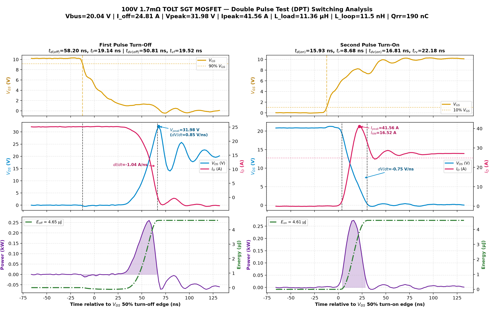

#### 4. 完整脚本

{}

### 最后分享一些遇到的坑

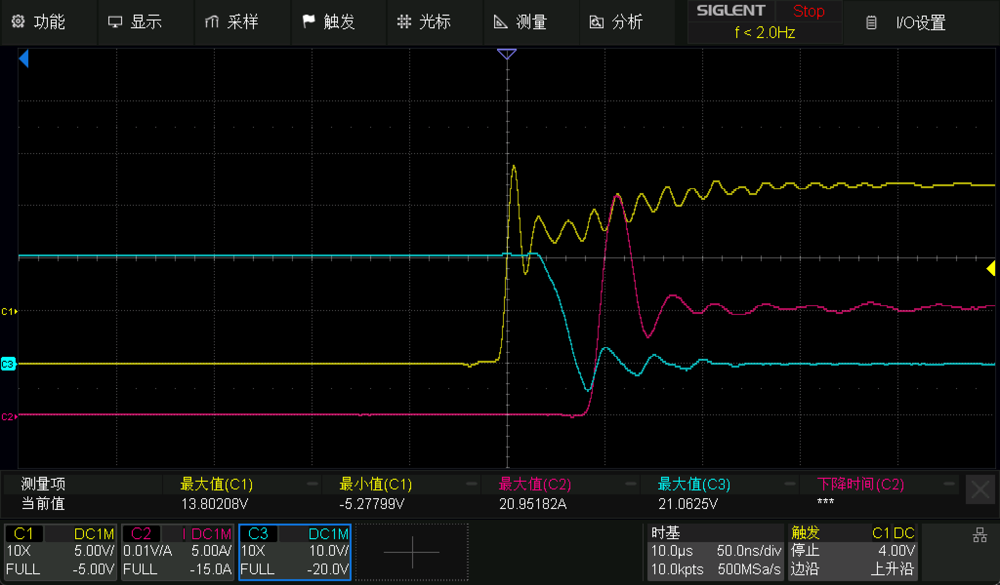

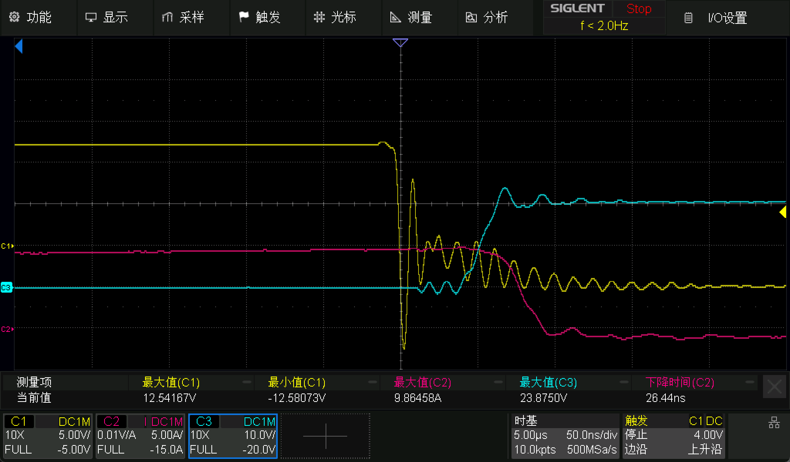

这是相同的测试平台、相同的 DUT 测出来的波形，振荡非常严重，ID 还有很明显的迟滞。原因是下面几个错误叠在一起：

1. **无源探头用了长接地夹**。MOS 开关动作极快，长接地夹和探头形成的回路就像一根天线，给波形带来强干扰，测到的就不是 MOS 上的实际波形了。解决方法：换接地弹簧，尽量缩短接地回路。
2. **VDS 探头和 VGS 探头的地接在了不同点位**。VDS 探头的接地端接到了功率 S 极，而 VGS 探头的地接的是 KS；两个探头的地在示波器端是相通的，开关瞬间 S 与 KS 之间有电位差，于是两个探头之间会流过电流，把 VGS/VDS 都弄脏。解决方法：两个探头的地都接 KS；如果预算允许（或者公司给报销），直接上差分探头甚至光隔离探头。
3. **电流波形没有做 Deskew 延时校准**。柔性罗氏线圈本身有传输延时，不做 Deskew 的话，波形整体会晚一点，算出来的开关时间和损耗都不准。解决方法：大多数示波器都能给每个通道单独调延时。调整时让关断波形里 ID 下降到底部的拐点与 VDS 关断电压最高点对齐即可。我这套设置了 +27 ns，基本就对上了。

另外，DIY 罗氏线圈还有自己的低频问题：电流阶跃后会出现平台凸起，关断后会有低频下冲。脚本里那个默认关闭的 `ENABLE_ROGOWSKI_COMP` 就是干这个的；打开后能把开通后的 +2 A 左右凸起和关断后的 −2.7 A 左右下冲压回 0 附近，同时不影响电流斜坡。参数在文件顶部的 `ROGOWSKI_PRESETS` 里，换探头只改预设即可。

最后提醒一句：桌面 DPT 的母线电容储量不小，第一次上电务必限流、加泄放电阻和 TVS，先从小电压/小占空比开始，确认波形和关断尖峰都正常再往上加。炸管是小事，别把眼睛和桌面搭进去。
