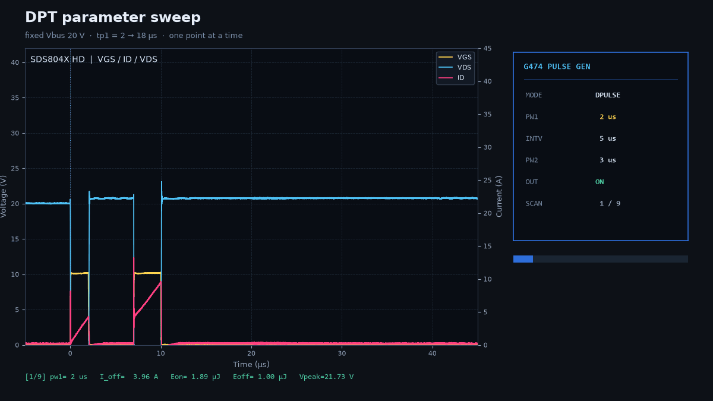
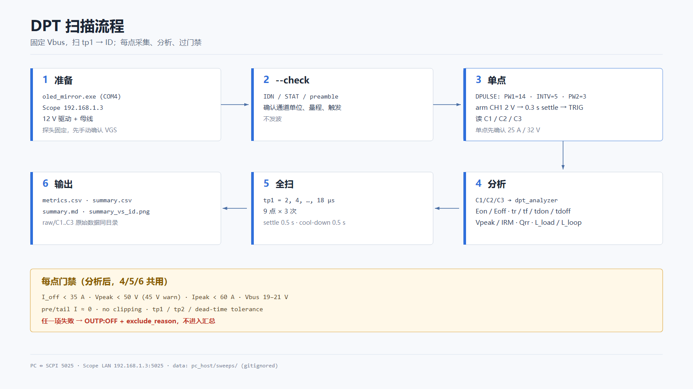
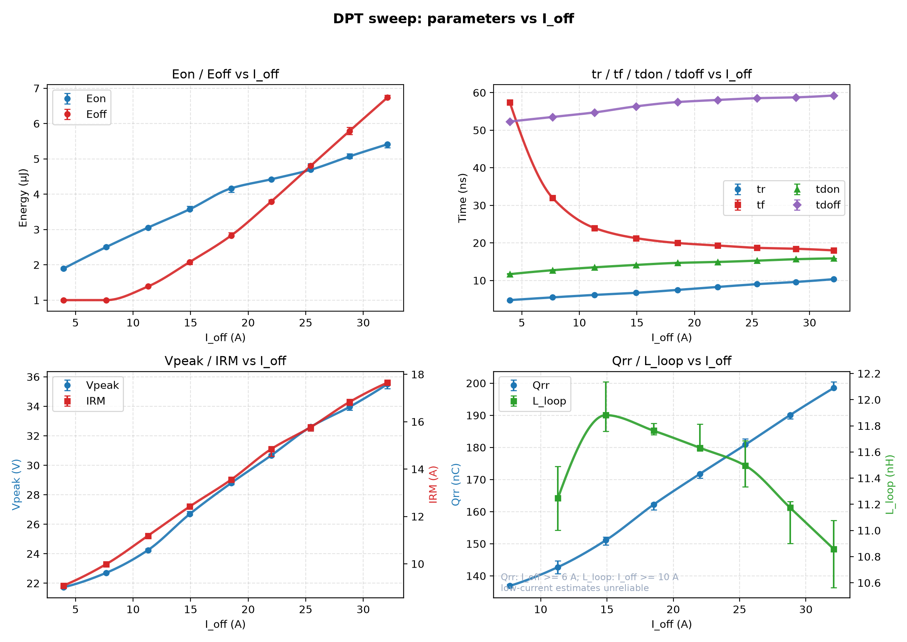

上一篇[在桌面搭建双脉冲测试平台](/double-pulse-test-at-home/)里，硬件和离线分析已经跑通了：示波器导出三份 CSV，Python 脚本算开关时间、损耗、L_load、L_loop 和 Qrr。但每次改脉宽、按触发、存数据、再跑分析，还是得手动来一遍。测一个工作点还行，想扫 `Eon/Eoff vs ID` 这种曲线，重复劳动就有点多了。

这篇把最后一段补上：**发波板的 SCPI Server + 示波器的 LAN SCPI + Python**，固定 20 V 母线，扫第一脉冲宽度 `tp1 = 2…18 µs`，对应 ID 约 4–32 A；9 个点、每点 3 次，自动采集、分析、过安全门禁，最后直接出曲线。

<!--more-->



## 1. 测试链路

平台本身和上一篇一样，这里只列和自动化相关的部分：

- **发波板**：G474PulseGen，USB-TTL 接 COM4；PC 端跑 `oled_mirror.exe`，它在 `127.0.0.1:5025` 开一个 TCP SCPI 服务端，负责把命令转给板子。
- **功率级**：100 V 1.7 mΩ TOLT SGT MOSFET 半桥；母线 20 V / 0.1 A 限流；负载电感 10.7 µH；Rg,ext = 1 Ω。
- **示波器**：SDS804X HD，LAN `192.168.1.3:5025`；CH1=VGS、CH2=ID（HQRocoil-Mini，0.01 V/A，示波器里单位设为 A、probe=100）、CH3=VDS。
- **采集设置**：25k 点、2 ns、50 µs 窗口；触发源 CH1、上升沿、2 V；单次采集后 Stop 再读三通道。

这里的“电流”仍然来自 DIY 罗氏线圈，低频 droop 和平台凸起还在。这篇文章只用它看相对趋势；绝对精度和正式 Qrr 需要更好的探头或补偿，后面会再提。

## 2. 自动触发：两个坑

第一版脚本是“设参数 → 武装示波器 → 发 `TRIG` → 等 Stop”。结果遇到了两个很典型的坑。

### 2.1 `TRIG` 返回 OK，但示波器不触发

发波板的 `TRIG` 命令返回 `OK`，`STAT` 里 `OUT=ON`，但示波器一直停在 `READY`。用板子上的物理触发键/OLED 的 TRIG 按钮却一切正常。最后定位到两点：

1. **每点只重发 `DPULS:PW1`**。早期版本在每个点又把 `DPULS:INTV`、`DPULS:PW2` 一起重发了一遍；这会在输出已经打开时重新设置双脉冲参数。改成和官方 `demo_scripts` 的 `double` 流程一致——初始化时设一次 `INTV/PW2`，循环里**只改 `PW1`，然后 `TRIG`**——就稳定了。
2. **arm 后等 0.3 s 再 `TRIG`**。示波器的 `:TRIGger:STATus?` 已经显示 `READY`，但触发系统可能还没真正稳定；手动触发天然有人的延迟，所以一直正常。脚本里加一个固定的 0.3 s settle，竞态就消失了。

现在每个点的顺序是：

```text
MODE:DPULSE
CHAN:1
DPULS:INTV:5
DPULS:PW2:3
DPULS:PW1:<N>
OUTP:ON

:TRIGger:MODE SINGle
# 等 0.3 s
TRIG
# 轮询到 STOP，再读 C1/C2/C3
```

`TRIG` 是单次事件，脚本**不会自动重发**：如果示波器没 Stop，直接终止该点，避免脉冲已经打出去、又让电感带残余电流再打一发。

### 2.2 探头接触与触发电平

中间还遇到过 VGS 探头没压实、自动触发时手一松就掉信号的情况。自动化的前提是探头**机械固定**——胶带、夹子、第三只手都行；一手按两个探头跑 27 个点是不现实的。

触发电平最后定在 **2 V**：VGS 高电平约 10 V，2 V 既能可靠触发，又不会被底噪误触发。脚本也保留了 `--manual-trigger` 兜底：每个点等 60 s，你手动按板子/OLED 的 TRIG，适合调试阶段。

## 3. 脚本与安全门禁

代码在 G474PulseGen 的 `pc_host` 下，分成三个文件：

- [`siglent_scope.py`](https://github.com/chenfangshuo/G474PulseGen/blob/master/pc_host/siglent_scope.py)：LAN 5025 SCPI、二进制块、346 字节 Preamble、WORD/12-bit 换算、三通道读取。
- [`pulsegen_scpi.py`](https://github.com/chenfangshuo/G474PulseGen/blob/master/pc_host/pulsegen_scpi.py)：复用 `demo_scripts.ScipClient`，封装 `MODE/DPULS/OUTP/TRIG/STAT`。
- [`dpt_sweep.py`](https://github.com/chenfangshuo/G474PulseGen/blob/master/pc_host/dpt_sweep.py)：扫描编排、安全门禁、调用 `dpt_analyzer`、输出 CSV/图和 Markdown 表。

最常用的三条命令：

```powershell
python dpt_sweep.py --check
python dpt_sweep.py --single --pw1 14
python dpt_sweep.py --pw1 2,4,6,8,10,12,14,16,18 --repeat 3
```

`--check` 只连仪器、打印 IDN/STAT/Preamble、不发波；`--single` 先跑一个 14 µs 点核对 25 A / 32 V；确认后再全扫。



门禁不是摆设。20 V 母线上最容易被忽略的是**母线固态电容的耐压**：这里是 2 颗 50 V/470 µF，所以 Vpeak 按 50 V 硬限、45 V 预警，而不是按 100 V 的 MOS 额定值。其余门禁包括：

- `I_off < 35 A`、`Ipeak < 60 A`；
- `Vbus` 在 19–21 V；
- pre-pulse / 尾段电流接近基线（判断上一发是否恢复）；
- 三个通道没有削顶；
- 实测 `tp1 / tp2 / 死区` 在公差内；
- 任一项失败：`OUTP:OFF`、记录 `exclude_reason`，不进入汇总。

每个点的原始三通道 CSV、`meta.json`、`metrics.csv`、`summary.csv`、`summary.md` 和 `summary_vs_id.png` 都在 `pc_host/sweeps/<时间戳>/` 下；`sweeps/` 已加进 `.gitignore`。

## 4. 结果

9 个点里 **25/27 次采集进入汇总**；4 µs 的 rep2 和 6 µs 的 rep3 被 `pre_current` 门禁标记，这两个点各用 2 次重复。没有触发安全上限。

### 4.1 开关时间与损耗

| I_off (A) | Eon (µJ) | Eoff (µJ) | tr (ns) | tf (ns) | tdon (ns) | tdoff (ns) |
|---:|---:|---:|---:|---:|---:|---:|
| 3.96 | 1.89 | 1.00 | 4.77 | 57.39 | 11.68 | 52.31 |
| 7.68 | 2.50 | 1.00 | 5.50 | 31.96 | 12.73 | 53.52 |
| 11.30 | 3.05 | 1.39 | 6.15 | 23.98 | 13.49 | 54.72 |
| 14.92 | 3.57 | 2.08 | 6.70 | 21.27 | 14.13 | 56.34 |
| 18.52 | 4.17 | 2.83 | 7.48 | 19.97 | 14.68 | 57.48 |
| 22.00 | 4.42 | 3.79 | 8.27 | 19.30 | 14.92 | 58.04 |
| 25.44 | 4.69 | 4.80 | 9.01 | 18.68 | 15.27 | 58.52 |
| 28.81 | 5.07 | 5.79 | 9.61 | 18.44 | 15.66 | 58.74 |
| 32.09 | 5.41 | 6.73 | 10.34 | 18.00 | 15.87 | 59.23 |

### 4.2 应力、Qrr 与 L_loop

| I_off (A) | Vpeak (V) | IRM (A) | Qrr (nC) | L_loop (nH) | L_load (µH) |
|---:|---:|---:|---:|---:|---:|
| 3.96 | 21.73 | 9.08 | — | — | 10.22 |
| 7.68 | 22.71 | 9.99 | 136.9 | — | 10.65 |
| 11.30 | 24.25 | 11.19 | 142.7 | 11.25 | 10.83 |
| 14.92 | 26.69 | 12.42 | 151.1 | 11.88 | 10.95 |
| 18.52 | 28.79 | 13.55 | 162.2 | 11.76 | 11.00 |
| 22.00 | 30.67 | 14.84 | 171.7 | 11.63 | 11.07 |
| 25.44 | 32.60 | 15.77 | 180.9 | 11.50 | 11.15 |
| 28.81 | 33.96 | 16.83 | 190.1 | 11.17 | 11.24 |
| 32.09 | 35.50 | 17.65 | 198.5 | 10.86 | 11.35 |

> Qrr 在 PW2=3 µs 下可能还没完全恢复，只作参考；要正式 Qrr/IRM 需要补一个 PW2=10 µs 的单点。4 A 的 Qrr 被低电流基线/恢复过程放大，图上从 6 A 开始；L_loop 在 10 A 以下因过冲和 dI/dt 太小不可靠，图上从 10 A 开始。完整数值仍在 `summary.csv`。



## 5. 讨论

**Eoff 在 25 A 左右超过 Eon。** 低电流时开通损耗占主导，因为输出电容的充电/放电和反向恢复都在开通瞬间发生；电流上来以后，关断时电流下降和电压上升重叠得更久，Eoff 增长更快。对实际电源来说，如果工作点在高电流区，Rg 和关断缓冲的优化优先级要高于开通。

**tf 从 57 ns 降到 18 ns，tr 从 4.8 ns 升到 10.3 ns。** 低电流时关断过程主要由输出电容和探头/回路的小电流噪声主导，电流波形“拖尾”很长；高电流时沟道电流占主导，下降更干脆。tr 随电流增大而变长，则和米勒平台、驱动电流被分摊有关。

**tdon 从 11.7 ns 增到 15.9 ns，tdoff 从 52.3 ns 增到 59.2 ns。** 这两个是“栅极到电流”的延时，受驱动器和米勒电容影响；它们随电流变大的趋势，说明高电流下栅极充电更慢，和 tr 的变化一致。

**L_loop 在 10 A 以上稳定在约 11 nH。** 和上一篇单点的 11.5 nH 一致。3.96 A 和 7.68 A 算出来的 31/14 nH 是低电流下过冲和 dI/dt 太小导致的估算噪声，不代表回路电感真的变了；图里已经把 10 A 以下的 L_loop 截掉。

**L_load 从 10.2 µH 到 11.4 µH。** 用第一脉冲 20%–80% 的 ID 线性拟合得到，设计值是 10.7 µH；低电流点拟合窗口内的电流小，估算偏差更大，整体在同一量级。

**Vpeak 从 21.7 V 升到 35.5 V。** 32 A 时相对 20 V 母线的过冲约 15.5 V，但离 50 V 电容硬限还有余量；18 µs 这个点已经接近本次扫描的上限，继续加电流要先确认电感和探头的量程。Qrr 则从约 137 nC 升到 198 nC，趋势是单调的，但记住它是在 PW2=3 µs 下测的，绝对值只作参考。

## 6. 复现与限制

复现需要：

- G474PulseGen 板 + `oled_mirror.exe`（COM 口按实际改），TCP 5025 在监听；
- 示波器 LAN 可达，`*IDN?` 正常；
- 12 V 驱动、20 V 母线、探头固定；
- Python 环境装 `pc_host/requirements-sweep.txt` 里的 `numpy/pandas/scipy/matplotlib`。

```powershell
cd pc_host
python dpt_sweep.py --check
python dpt_sweep.py --single --pw1 14
python dpt_sweep.py --pw1 2,4,6,8,10,12,14,16,18 --repeat 3
```

如果自动触发偶发不中，先用 `--manual-trigger` 手动按板子 TRIG 排除探头/触发问题，再回头查 SCPI 链路。

这次扫描的边界也很明确：固定 20 V，只扫了 `tp1`，没有扫 Rg、温度、母线电压；探头是 70 MHz 示波器 + 无源探头 + DIY 罗氏线圈，L_loop/Qrr 的绝对值有测量不确定度；2 个 `pre_current` 点只有 2 次重复。下一轮可以先加继电器 Rg 阵列，或者用加热台做温度扫描——但继电器阵列在栅极回路，低 Rg 点的栅极电感要单独评估，别把测试条件本身改变了。

## 7. 小结

从“手动按一次、抄一次数”到“9 点 ×3 次自动扫完”，这套桌面 DPT 平台现在能直接产出 `Eon/Eoff`、开关时间、`Vpeak/IRM`、`Qrr/L_loop` 随 ID 变化的曲线。硬件还是那套手搓的 TOLT 半桥，变化的只是把发波板、示波器和 Python 串成了一条可复现的测量链。

对我来说，这次最大的收获不是某一条曲线，而是把“自动触发为什么不中”拆成了可复现的两个坑：**每点只改 PW1**、**arm 后等 0.3 s**。这两个细节比脚本本身更值得记下来。下一篇如果做 Rg/温度扫描，思路是一样的：先把单点跑稳，再把参数矩阵交给脚本。
