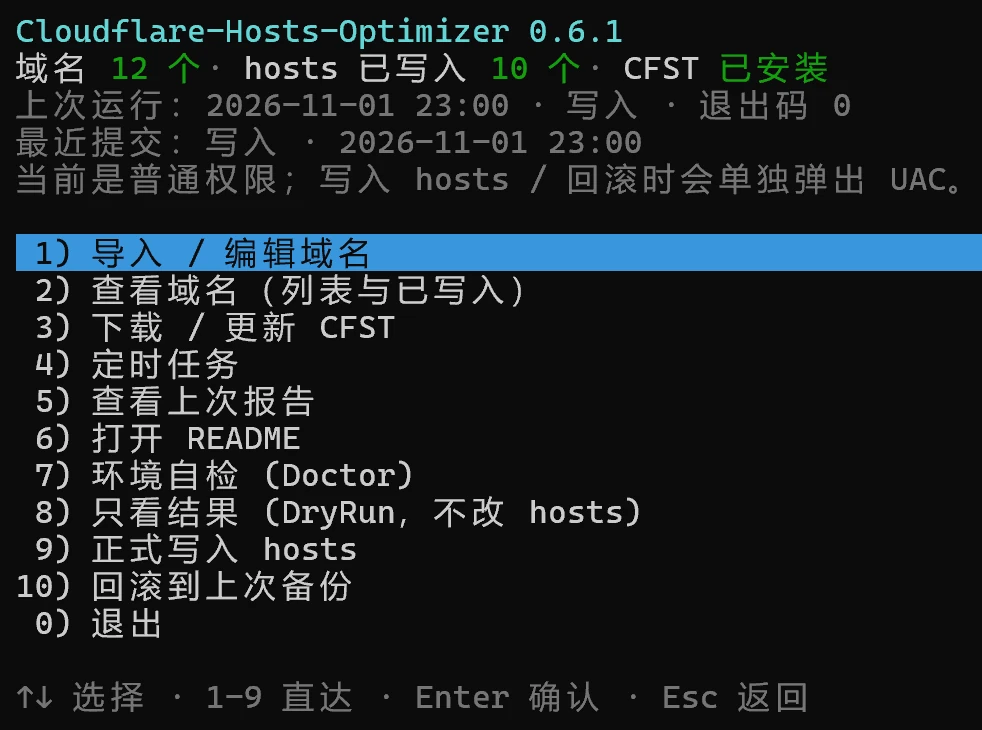
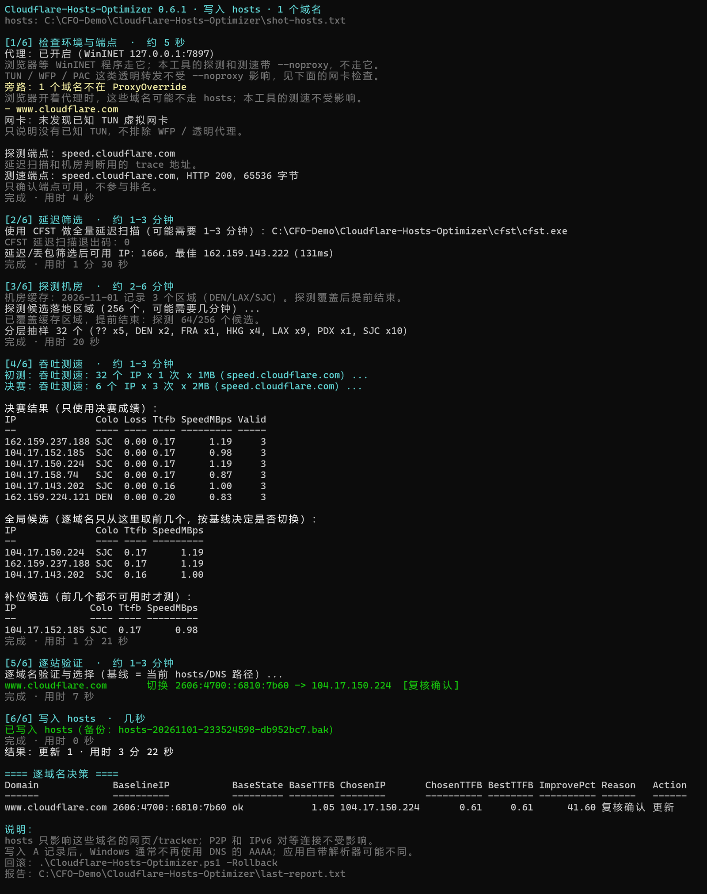

很多套了 Cloudflare 的站点，打开速度取决于你被分到哪个边缘节点。我这边（河北联通）访问大部分 PT 站都很慢，有的甚至完全进不去。用 [CloudflareSpeedTest（CFST）](https://github.com/XIU2/CloudflareSpeedTest) 优选后手动写 hosts 确实能改善，但 CFST 选出的 IP 不一定对每个站都最优：有的 IP 测速数据漂亮，一访问站点却提示 1034（Edge IP Restricted）；而且 CFST 自带的默认测速地址已不由作者维护（[issue #168](https://github.com/XIU2/CloudflareSpeedTest/issues/168)），直接用 CFST 测速会返回 403，等于测不出速度。所以这个脚本只用 CFST 做延迟筛选，吞吐测试改用 Cloudflare 的公共端点，再逐站点挑合适的 IP。

`Cloudflare-Hosts-Optimizer` 就是为这个写的：一个为 Windows 10/11 设计的 PowerShell 脚本，测出当前线路到 Cloudflare 各边缘节点较快的 IP，逐站验证可用后写进 hosts。它只改善网页 TTFB，不影响 P2P；不代理、不登录、不改出口 IP。我这边优选后，一个原本要 >10 秒才能加载完的站，现在 3 秒左右就能打开。

<!--more-->

## 它做什么

- 提供 `Start.bat` 菜单：导入域名、DryRun、写入 hosts、回滚；也可以走命令行；
- 输入 `domains.txt`，测出当前线路到 CF 边缘节点较快的 IPv4；
- 对每个域名发少量 HEAD 请求，确认这个 IP 真的能打开站点；
- 只维护 hosts 里一个带标记的区块，支持备份和一键回滚。

它不改变出口 IP（前提是这些域名在代理旁路里），也不影响 BitTorrent 的 P2P 连接。**下载速度不会因此变快**——hosts 只影响这些域名的网页访问。

## 怎么用



**1）下载并双击 `Start.bat`**

到 [Releases](https://github.com/chenfangshuo/Cloudflare-Hosts-Optimizer/releases/latest) 下载最新的 zip，解压到任意目录（不要在压缩包里直接运行），进入里面的 `Cloudflare-Hosts-Optimizer` 目录，双击 `Start.bat`。

它会自动找 PowerShell 7；没有会问你要不要用 winget 安装。启动后是一个用方向键选择的菜单，不用记命令。

**2）按 1 导入 / 编辑域名**

可以从 PT-Depiler 备份、Windows 代理旁路、文本或剪贴板导入，也可以选「手动编辑」，用记事本一行写一个域名。建议只填确认由 Cloudflare 代理的站点——填错了也不会写坏，逐站验证会跳过它，只是白跑一次。

导入会先把结果写到 `domains.imported.txt` 给你确认，再合并到 `domains.txt`，不会直接改主列表。

**3）（可选）按 3 下载 / 更新 CFST**

候选覆盖更广、通常效果更好；不装也能用内置扫描，只是会漏掉一些好 IP。菜单里能直连 GitHub 就直连，不行就选系统代理，或者用浏览器打开菜单里给的蓝奏云下载页，下载 zip 后用「从本地 zip 安装」。

**4）（可选）按 8 只看结果**

不写 hosts，先看一遍切换和保留是否符合预期。注意 **DryRun 也会真实请求一轮**；紧接着再正式写入，等于每个站点被请求两次。

**5）按 9 正式写入**

会弹一次 UAC，需要管理员权限。不满意随时选中第 10 项「回滚到上次备份」——用方向键移过去，不是先按 1 再按 0。

菜单按键：`↑`/`↓` 选择，`1–9` 直达前九项，第 10 项用方向键移过去，`0` 退出 / 返回，`Enter` 确认，`Esc` 返回。首次运行约 8–15 分钟，过程中会打印步骤名、预计时间和一行转轮，不是卡死。

需要命令行、定时任务或完整参数，见仓库的 [`docs/guide.md`](https://github.com/chenfangshuo/Cloudflare-Hosts-Optimizer/blob/main/docs/guide.md)。

## 它怎么选

1. **测延迟**：CFST（或内置扫描）先按延迟和丢包筛掉大部分 IP；
2. **测速度**：按落地机房分层抽样，独立吞吐初测 + 3 × 2MB 决赛；
3. **和基线比**：每个域名以当前 hosts/DNS 为基线逐站验证，准备切换时基线与候选各复核一次；只有快 ≥15% 且 ≥30ms，或基线不可用/类别更差时才切换。

这样做的原因是：同一个 CF 边缘 IP 能服务任何 CF 站点，但不同站点到不同机房的 TTFB 不一样；单纯按延迟排序也容易高估香港机房——握手快，大流量却可能丢包。

## 运行效果



这是一次用临时 hosts 跑的演示（域名 `www.cloudflare.com`），所以不会碰系统 hosts；正式写入时会弹 UAC。截图里能看到 6 个步骤的进度和最终决策表：基线 TTFB 1.05s，切到 `104.17.150.224` 后 0.61s，改善 41.60%。

## 注意事项

1. **第一次运行约 8–15 分钟**，写入 hosts 需要管理员权限；hosts 只影响本机，不改变站点看到的来源。
2. **无论 DryRun 还是正式写入**，每个域名典型只发 6–10 次首页 HEAD（最坏 11 次，同一个 IP 最多 2 次，间隔 400ms），**不登录、不带 Cookie、不读 passkey、不访问 announce、不连 tracker 端口**；批量测速只打 `speed.cloudflare.com`；只处理你写进 `domains.txt` 的域名，不会自动发现或爬取站点。
3. 默认只新增/更新列表里的域名，**不删除其他托管条目**；只有 `-Prune` 才会清理不在列表里的旧映射。
4. Clash 的**系统代理**模式不用关（所有 curl 都带 `--noproxy '*'`，CFST 启动前会清空代理环境变量）；如果开了 **TUN / 透明代理**，工具会在扫描前中止（`--noproxy` 绕不过 TUN），请先关闭 TUN、保持家宽直连再跑。浏览时想走 hosts，需要关掉代理或把域名加进旁路——开着 Clash 时 hosts 不参与解析。
5. 优选出的 IP 会随时间变化，建议 **1–2 周重跑一次**；hosts 不影响 P2P；暂不做 IPv6 优选。
6. **不建议把 `tracker.example.com` 这类汇报子域名写进列表**：announce 是每 30 分钟一次的几十字节请求，优选没有收益；映射一旦过期或变成 1034，汇报失败反而会红种。如果站点是 `example.com/announce.php` 这种同域名结构就分不开，只能靠定期重跑和回滚兜底。
7. **DryRun 不会减少请求量**。如果对某个站点的请求频率有顾虑，可以调低 `-MaxDomainProbes`（每域名候选探测上限，默认 6）、`-CandidatesPerDomain`（默认 3）、`-BackfillCandidates`（默认 1），把 `-VerifyDelayMs` 从 400ms 调大。比如：

   ```powershell
   .\Cloudflare-Hosts-Optimizer.ps1 -MaxDomainProbes 3 -CandidatesPerDomain 2 -BackfillCandidates 0 -VerifyDelayMs 1000
   ```

   减少候选数会牺牲一点选择余地；调大验证间隔只会让运行更慢，不改变判定结果。**如果站点管理员认为默认频率不合适，可以直接告诉我，我会调整默认值。**

## 最后

仓库在 [chenfangshuo/Cloudflare-Hosts-Optimizer](https://github.com/chenfangshuo/Cloudflare-Hosts-Optimizer)，MIT 协议，不含任何第三方二进制；CFST 是可选的，安装器会在需要时从官方仓库下载。有问题可以直接提 [Issue](https://github.com/chenfangshuo/Cloudflare-Hosts-Optimizer/issues)。
