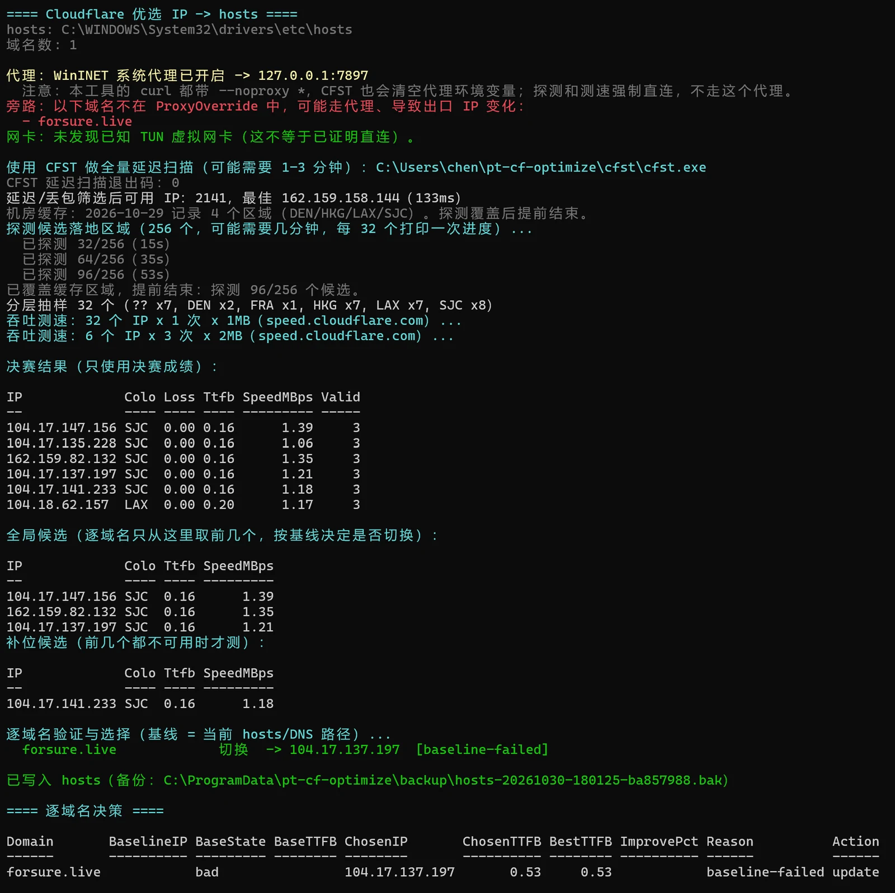

很多套了 Cloudflare 的站点，打开速度取决于你被分到哪个边缘节点。我这边（河北联通）访问大部分 PT 站都很慢，有的甚至完全进不去。用 [CloudflareSpeedTest（CFST）](https://github.com/XIU2/CloudflareSpeedTest) 优选后手动写 hosts 确实能改善，但 CFST 选出的 IP 不一定对每个站都最优：有的 IP 测速数据漂亮，一访问站点却提示 1034（Edge IP Restricted）；而且 CFST 默认的测速地址已经不由作者维护（[issue #168](https://github.com/XIU2/CloudflareSpeedTest/issues/168)），我这边访问直接返回 403，当前版本会判为失败，等于测不出速度。

所以我写了 `Cloudflare-Hosts-Optimizer`：在 Windows 上测出当前线路到 Cloudflare 各边缘节点较快的 IP，逐站验证可用后写进 hosts。它只改善网页 TTFB，不影响 P2P；不代理、不登录、不改出口 IP。我这边优选后，一个原本要 >10 秒才能加载完的站，现在 3 秒左右就能打开。

<!--more-->

## 它做什么

- 输入 `domains.txt`，测出当前线路到 CF 边缘节点较快的 IPv4；
- 对每个域名发少量 HEAD 请求，确认这个 IP 真的能打开站点；
- 只维护 hosts 里一个带标记的区块，支持备份和一键回滚。

它不改变出口 IP（前提是这些域名在代理旁路里），也不影响 BitTorrent 的 P2P 连接。**下载速度不会因此变快**——hosts 只影响这些域名的网页访问。

## 怎么用

**1）下载脚本**

到 [Releases](https://github.com/chenfangshuo/Cloudflare-Hosts-Optimizer/releases/latest) 下载压缩包。资源管理器的「全部解压缩」会先建一个以压缩包命名的目录，里面才是 `Cloudflare-Hosts-Optimizer\`，脚本和 `lib\` 都在这一层——进入内层目录运行。需要 Windows 10/11、PowerShell 7+，以及系统自带的 `curl.exe`。

**2）可选：放好 CFST**

从 [CloudflareSpeedTest Releases](https://github.com/XIU2/CloudflareSpeedTest/releases/latest) 下载 `cfst.exe` 和 `ip.txt`，放到脚本旁的 `cfst\` 目录：

```text
Cloudflare-Hosts-Optimizer\
  cfst\
    cfst.exe
    ip.txt
```

不放也能用，脚本会自动回退到内置扫描，但一般 CFST 的候选覆盖更广、效果更好。

**3）准备域名**

`domains.txt` 一行一个域名，建议只填确认由 Cloudflare 代理的站点。填错了也不会写坏，逐站验证会跳过它，只是白跑一次。

也可以从这些来源导入：

```powershell
.\Import-Domains.ps1 -Source Depiler -Path '.\PTD_backup.zip' -Merge
.\Import-Domains.ps1 -Source ProxyBypass -Merge
.\Import-Domains.ps1 -Source Text -Path .\sites.txt -Merge
.\Import-Domains.ps1 -Source Clipboard -Merge
```

导入后先检查 `domains.txt` 里确实是需要的域名，再往下跑。

**4）先看结果，再写 hosts**

DryRun 不需要管理员，也不会改 hosts；但**扫描、测速和逐站 HEAD 验证都会照常执行**——它只是不写入，不是完全不发请求。

```powershell
pwsh -NoProfile -ExecutionPolicy Bypass -File .\Cloudflare-Hosts-Optimizer.ps1 -DryRun
```

看一眼决策表，确认没问题后，用管理员 PowerShell 正式写入：

```powershell
pwsh -NoProfile -ExecutionPolicy Bypass -File .\Cloudflare-Hosts-Optimizer.ps1
```

**5）出问题一键回滚**

```powershell
pwsh -NoProfile -ExecutionPolicy Bypass -File .\Cloudflare-Hosts-Optimizer.ps1 -Rollback
```

需要定时运行的话，见 [`docs/scheduling.md`](https://github.com/chenfangshuo/Cloudflare-Hosts-Optimizer/blob/main/docs/scheduling.md)。

## 它怎么选

1. **测延迟**：CFST（或内置扫描）先按延迟和丢包筛掉大部分 IP；
2. **测速度**：按落地机房分层抽样，独立吞吐初测 + 3 × 2MB 决赛；
3. **和基线比**：每个域名以当前 hosts/DNS 为基线逐站验证，准备切换时基线与候选各复核一次；只有快 ≥15% 且 ≥30ms，或基线不可用/类别更差时才切换。

这样做的原因是：同一个 CF 边缘 IP 能服务任何 CF 站点，但不同站点到不同机房的 TTFB 不一样；单纯按延迟排序也容易高估香港机房——握手快，大流量却可能丢包。

## 运行效果



这次 `forsure.live` 的基线不可用，脚本直接选了 `104.17.137.197`，TTFB 0.53s。截图里也能看到代理旁路的提示：如果域名不在 `ProxyOverride` 里，脚本会提醒出口 IP 可能变化。（截图取自改名前的运行记录，截图里的旧目录名现在已换成 `Cloudflare-Hosts-Optimizer`。）

## 注意事项

1. **第一次运行约 8–15 分钟**，写入 hosts 需要管理员权限；hosts 只影响本机，不改变站点看到的来源。
2. **无论 DryRun 还是正式写入**，每个域名典型只发 6–10 次首页 HEAD（最坏 11 次，间隔 400ms），**不登录、不带 Cookie、不读 passkey、不访问 announce、不连 tracker 端口**；批量测速只打 `speed.cloudflare.com`；只处理你写进 `domains.txt` 的域名，不会自动发现或爬取站点。
3. 默认只新增/更新列表里的域名，**不删除其他托管条目**；只有 `-Prune` 才会清理不在列表里的旧映射。
4. 跑脚本时不用关 Clash（所有 curl 都带 `--noproxy '*'`，CFST 启动前会清空代理环境变量）；但**浏览时想走 hosts，需要关掉代理，或把域名加进代理旁路**——开着 Clash 时 hosts 不参与解析。
5. 优选出的 IP 会随时间变化，建议 **1–2 周重跑一次**；hosts 不影响 P2P；暂不做 IPv6 优选。
6. **不建议把 `tracker.example.com` 这类汇报子域名写进列表**：announce 是每 30 分钟一次的几十字节请求，优选没有收益；映射一旦过期或变成 1034，汇报失败反而会红种。如果站点是 `example.com/announce.php` 这种同域名结构就分不开，只能靠定期重跑和回滚兜底。
7. **DryRun 不会减少请求量**。如果对某个站点的请求频率有顾虑，可以调低 `-MaxDomainProbes`（每域名候选探测上限，默认 6）、`-CandidatesPerDomain`（默认 3）、`-BackfillCandidates`（默认 1），把 `-VerifyDelayMs` 从 400ms 调大。比如：

   ```powershell
   .\Cloudflare-Hosts-Optimizer.ps1 -MaxDomainProbes 3 -CandidatesPerDomain 2 -BackfillCandidates 0 -VerifyDelayMs 1000
   ```

   减少候选数会牺牲一点选择余地；调大验证间隔只会让运行更慢，不改变判定结果。**如果站点管理员认为默认频率不合适，可以直接告诉我，我会调整默认值。**

## 最后

仓库在 [chenfangshuo/Cloudflare-Hosts-Optimizer](https://github.com/chenfangshuo/Cloudflare-Hosts-Optimizer)，MIT 协议，不含任何第三方二进制（CFST 需自行下载）。有问题可以直接提 [Issue](https://github.com/chenfangshuo/Cloudflare-Hosts-Optimizer/issues)。
